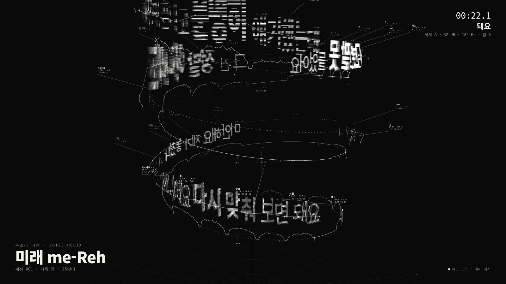
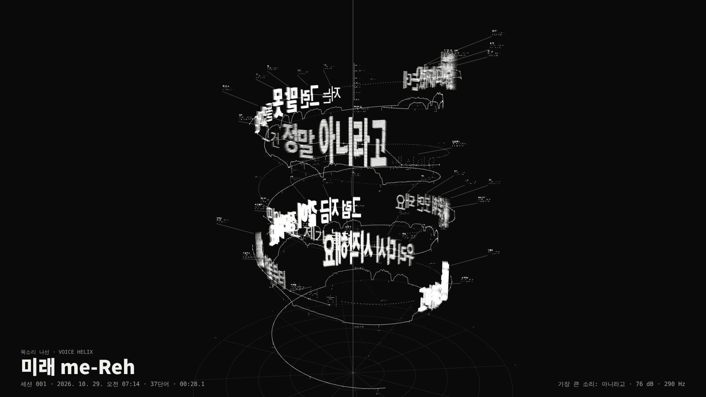

# 미래 me-Reh v0.4 — 목소리 나선 (설치 버전)

전시장에 놓고 계속 돌아가는 설치 작품 버전입니다. 관람객이 마이크에 말하면, 그 말이 흑백 선으로 된 글자가 되어 나선 위에 새겨집니다.
- **음높이:** 글자의 높이
- **음량:** 선의 밀도와 겹 수
- **시간:** 나선을 따라 흐름 (한 바퀴 8초)

키보드 **1번(Start)**으로 기록을 시작하고 **2번(Stop)**으로 끝내면, 그 세션이 이미지와 기록으로 저장됩니다. 화면은 방금 만들어진 조각을 천천히 돌리며 다음 기록을 기다립니다. 기록 중에도 마우스로 조각을 돌려 보고 확대·축소할 수 있습니다.

모든 처리는 노트북 안에서 이루어집니다. 음성 인식(Whisper), 3D 라이브러리, 글꼴 모두 로컬에서 동작해서 **인터넷이 없는 전시장에서도 돌아갑니다.**

| 전시 중 화면 | 세션이 끝나면 저장되는 이미지 |
|---|---|
|  |  |

> 예시 이미지는 데모 대사로 만들었습니다.

## 준비물

- Apple 칩(M1 이상) 맥, Google Chrome
- 마이크 (단일 지향성 핸드헬드나 스탠드 마이크 권장. 노트북 내장 마이크는 관람객 소리가 작게 들어감)
- 프로젝터나 대형 모니터 (16:9)

## 1. 설치 (처음 한 번, 인터넷 되는 곳에서)

1. 이 폴더(`v0.4-installation`)를 맥의 원하는 곳에 둡니다.
2. `setup_mac.command`를 **오른쪽 클릭 → 열기**로 실행합니다. 10~20분 걸리고, 약 2GB를 내려받습니다.
3. 마지막에 "모델 시험 실행 성공"과 "설치가 끝났습니다"가 나오면 완료입니다.

## 2. 전시 시작 (매일)

1. 마이크를 연결하고, **시스템 설정 → 사운드 → 입력**에서 그 마이크를 고릅니다.
2. `start_installation.command`를 엽니다. 처음에는 오른쪽 클릭 → 열기로 엽니다.
3. 인식 프로그램이 준비되면 Chrome이 전체 화면으로 열립니다.
4. **처음 한 번만** 마이크 허용을 눌러 주세요. 전시 전용 Chrome 프로필에 기억되어, 다음부터는 묻지 않습니다.
5. 끝낼 때는 **⌘Q**를 누릅니다. 인식 프로그램도 함께 꺼집니다.

> 터미널 창은 닫지 마세요. 그 창이 열려 있는 동안 인식이 돌아가고, 맥이 잠자기에 들어가지 않습니다.

### 맥을 켜면 자동으로 시작하게 하려면

**시스템 설정 → 일반 → 로그인 항목**에서 `start_installation.command`를 추가합니다. 함께 해 두면 좋은 설정은 이렇습니다.
- **시스템 설정 → 잠금 화면:** 디스플레이 끄기 "안 함"
- **방해금지 모드:** 켜기
- **소프트웨어 업데이트:** 자동 설치 끄기

## 3. 기록 흐름

화면 아래에는 `Start 1   Stop 2`만 표시되고, 지금 누를 수 있는 쪽이 밝게 보입니다.

1. **대기:** 지난 기록의 조각이 천천히 돕니다. 이때는 소리가 들려도 기록하지 않습니다.
2. **1번 (Start):** 새 나선이 시작됩니다. 말한 지 0.5~1.5초 뒤 단어가 확정되면, 그 단어가 선으로 그려지며 새겨집니다.
   - 확정 전에도 진폭 고리선과 커서가 바로 움직이고, 인식 중인 글자가 커서 끝에 흐리게 보입니다.
3. **2번 (Stop):** 말하던 중이면 그 말까지 인식한 뒤, 가장 크게 말한 단어가 정면에 오도록 전체를 찍어 저장합니다. 그 뒤 대기 화면으로 돌아갑니다.

### 마우스로 보기 (기록 중에도 가능)

| 동작 | 결과 |
|---|---|
| 끌기 | 조각을 여러 방향으로 돌려 보기 |
| 휠 / 트랙패드 두 손가락 | 확대·축소 (멀리 빼면 세션 전체가 보임) |
| 오른쪽 끌기 / Shift+끌기 | 나선을 위아래로 옮겨 지난 말 보기 |
| 두 번 클릭 | 자동 시점으로 돌아가기 |

손을 떼고 12초가 지나면 자동 시점(방금 새겨진 단어를 정면에 두는 시점)으로 돌아갑니다. 마우스 커서는 움직일 때만 보이고 3초 뒤 숨습니다.

## 4. 세션 기록

`archive` 폴더에 세션마다 두 파일이 쌓입니다.

| 파일 | 내용 |
|---|---|
| `20261029-143012_session004.png` | 세션 전체 이미지 (화면 해상도, 제목·날짜·단어 수·가장 큰 소리 표기) |
| `20261029-143012_session004.json` | 단어·음절마다 시간, 음량, 음높이 기록 |

## 5. 설정

`start_installation.command`를 텍스트 편집기로 열면 맨 위에서 바꿀 수 있습니다.

| 설정 | 기본 | 뜻 |
|---|---|---|
| `IDLE` | 0 | 0이 아니면, 이 시간(초) 동안 말이 없을 때 자동으로 끝내고 저장 |
| `AUTO_START` | 0 | 1이면 1번을 누르지 않아도 목소리가 들리면 바로 기록 시작 |
| `LANG_CODE` | ko | 인식 언어 (ko / en / ja) |
| `INVERT` | 0 | 1이면 흰 바탕에 검은 선 |
| `DATA` | 1 | 0이면 수치·측정선을 숨기고 글자 선만 |
| `DEMO` | 0 | 1이면 마이크 없이 예시 대사로 계속 돌림 (설치 점검용) |

## 6. 운영자 단축키

전시 화면에서 키보드로 조작합니다. 프레젠터 리모컨이나 숫자 패드의 1·2 키도 됩니다.

| 키 | 동작 |
|---|---|
| H | 도움말 + 마이크 보정값(입력·소음·큰 소리 dB) 보기 |
| F | 전체 화면 |
| I | 흑백 반전 |
| D | 수치·측정선 켜기/끄기 |
| 1 | Start: 기록 시작 |
| 2 | Stop: 기록 끝내고 저장 |
| A / B | 화자 A (가로 결) / 화자 B (세로 결). 두 사람이 공연할 때 |

## 7. 문제가 생기면

- **오른쪽 아래가 "인식 프로그램 연결 중…"에서 멈춤:** 터미널 창에 "준비 완료"가 떴는지 확인하세요. 화면은 연결이 끊겨도 2.5초마다 다시 연결합니다.
- **"마이크를 열 수 없습니다":** 마이크 연결과 사운드 입력 설정을 확인한 뒤, ⌘Q로 닫았다가 다시 시작하세요.
- **글자가 너무 작거나 크게만 나옴:** H를 눌러 보정값을 확인하세요. 처음 몇 초는 보정 중이라, 평소 목소리로 한두 문장 말하면 맞춰집니다. 마이크 입력 볼륨이 너무 낮으면 사운드 설정에서 올려 주세요.
- **확정이 너무 늦음:** 더 작은 모델을 씁니다. 터미널에서 `MEREH_MODEL=mlx-community/whisper-small-mlx bash setup_mac.command` 로 한 번 설치하고, 실행할 때도 같은 변수를 붙입니다.
- **화면만 점검하고 싶음:** `DEMO=1`로 바꾸고 실행하면 마이크 없이 예시 대사가 반복됩니다.

## 파일

| 파일 | 내용 |
|---|---|
| `me-Reh_helix_installation.html` | 전시 화면 |
| `mereh_whisper_server.py` | 로컬 Whisper 인식 + 화면 제공 + 세션 저장. `/caption`으로 열면 v0.3 자막 화면 |
| `setup_mac.command` / `start_installation.command` | 설치 / 전시 실행 |
| `vendor/three.min.js` | 3D 라이브러리 three.js r128 (MIT, `vendor/three.LICENSE`) |
| `images/` | 예시 이미지 |

## 검증 범위

작업 환경에서 두 경로를 끝까지 돌려 확인했습니다.
1. 데모 대사 37단어 → 세션 시작 → 나선 생성 → 4초 무음 → 저장(PNG·JSON)
3. 가상 마이크 → 1번 전에는 기록 안 함 → 1번으로 시작 → 끌기·휠로 시점 조작 → 2번으로 저장
2. 가상 마이크 녹음 + 시험용 인식 엔진 → 단어별 음량·음높이 기록(예: "아니라고" 1.0 / 294 Hz, "했잖아요" 0.19 / 148 Hz) → 무음 뒤 저장

실제 mlx-whisper, 맥 키오스크 실행, 실물 마이크는 맥에서 확인이 필요합니다.
